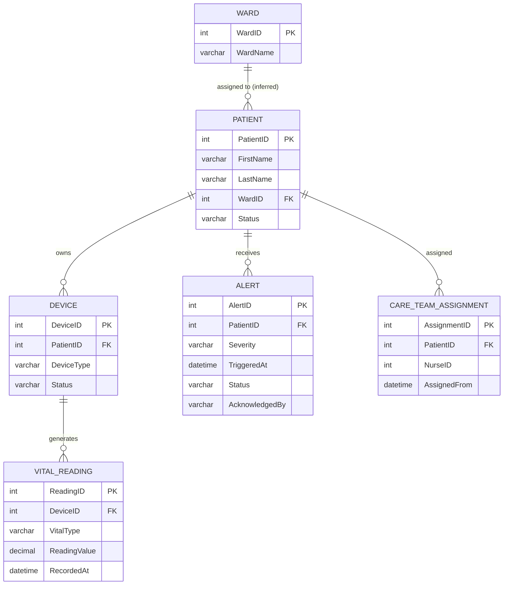

# VitalWatch Entity Relationship Diagram

The diagram contains the six entities listed in the project specification.

## Relationship note

The specification explicitly lists four relationships: Patient–Device, Device–VitalReading, Patient–Alert, and Patient–CareTeamAssignment.

The Ward–Patient relationship is inferred from the Patient entity's WardID field. Confirm with the trainer whether WardID should be implemented as a foreign key before finalizing the database schema.

## Design note

The entity names and attribute names follow the project specification. The SQL data types shown here are provisional and will be finalized during MySQL 8 schema design.
